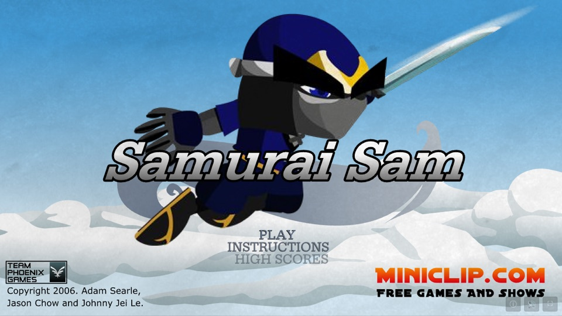
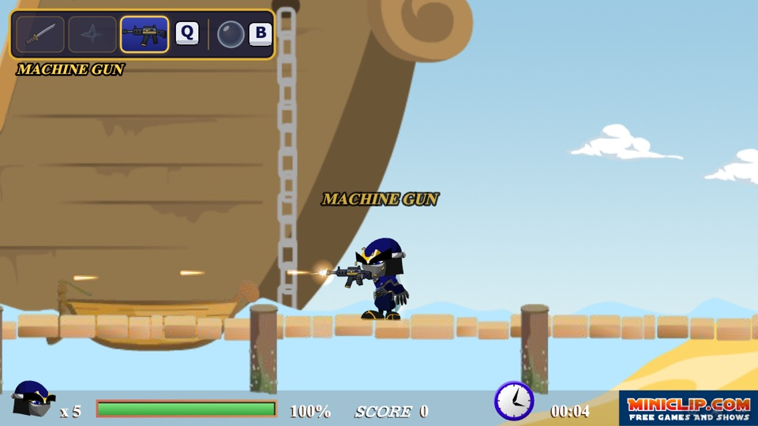
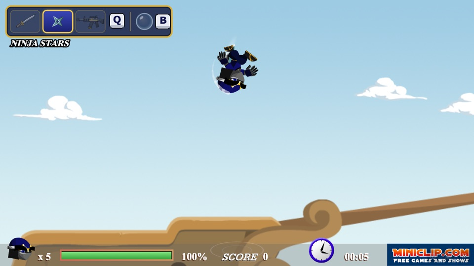

<div align="center">

# 🥷 Samurai Sam

**The 2006 Miniclip Flash classic, running again in a modern browser without Flash.**<br>
Now with ninja stars, a machine gun, a bubble shield and a triple-jump flip.




</div>

---

## ▶️ Play

**No install needed.** Download the repo and open **`dist/index.html`** in Chrome, Safari or Firefox.
You don't need a server or an internet connection: the art, sounds, levels and code are all in `dist/`.

```sh
git clone https://github.com/CassimClick/samurai-sam.git
open samurai-sam/dist/index.html      # macOS: or just double-click the file
```

## 🎮 Controls

| Key | Action |
|---|---|
| ← → | Move (double-tap to roll) |
| ↑ ↓ | Climb ladders, aim special moves |
| **Space** | Jump: press up to **3 times**, each jump goes higher and the third is a **flip** |
| **Z** | Attack (hold for automatic fire with the machine gun) |
| **X** | Defend / deflect |
| **Q** | Switch weapon: Sword → Ninja Stars → Machine Gun |
| **B** | Turn the bubble shield on or off |

The corner buttons are ⓘ credits (pauses the game), 🔊 sound on/off and ⛶ fullscreen.
You can remap the original keys in the in-game **CONTROLS** menu.

## ✨ New in this version

These are mods built on top of the original game. The original game code is unchanged; it lives in [`src/mod/`](src/mod/).

<table>
<tr>
<td width="50%"></td>
<td width="50%"></td>
</tr>
<tr>
<td><b>🔫 Machine gun</b>: hold Z for full-auto fire. It has hand-drawn rifle art, a muzzle flash, tracers, ejecting shell casings and a synthesized rifle sound with echo.</td>
<td><b>🫧 Bubble shield</b>: press B to put a see-through bubble around Sam. Enemy attacks bounce off it from every side, and it ripples when hit. It doesn't stop thorns or falls.</td>
</tr>
<tr>
<td></td>
<td valign="top">
<b>⭐ Ninja stars</b>: tap Z to throw. Tap again quickly to throw more. In the air, stars fly diagonally down. They stick in walls.<br><br>
<b>🌀 Triple jump</b>: Sam rises about 120px, then 170px, then 250px. The third jump is a full flip.<br><br>
<b>🗡️ Sword specials</b>: direction + Z specials (uppercut, windmill, power slash…) still use the sword whatever weapon you hold.<br><br>
<b>🧭 HUD</b>: the panel at the top left shows your current weapon and whether the bubble is on.
</td>
</tr>
</table>

## 🛠️ How it was rebuilt

There was no source code, so everything is rebuilt from the original **`samuraisam.swf`**. That file and the two level files were recovered from the Wayback Machine. The game's own ActionScript, animations and level data run unchanged, so the moves, combos, enemy AI, hitboxes and timings match the original.

```
samuraisam.swf ──► JPEXS FFDec ──► .extract/ ──► tools/build-data.mjs ──► public/data/ ──► src/flash/ engine ──► <canvas>
                   (decompile)     AS2, SVG,      shapes → Path2D,          bundle.js       TypeScript Flash 8
                                   sounds, XML    AS2 → JavaScript          scripts.js      runtime, 25 fps
```

1. **`npm run extract`** decompiles the SWF with [JPEXS FFDec](https://github.com/jindrapetrik/jpexs-decompiler). The output (ActionScript, vector shapes, bitmaps, sounds, fonts and timelines) goes to `.extract/`.
2. **`npm run build:data`** converts that output into `public/data/`:
   - It turns the vector shapes into compact path lists drawn with canvas `Path2D`.
   - It writes sprite timelines, buttons and text fields as JSON.
   - It transpiles the ActionScript 2 code to JavaScript ([`tools/lib/as2.mjs`](tools/lib/as2.mjs)). AS2 behaviour is kept: timeline scope, silent `undefined` access, Flash 4 operators and `tellTarget`.
   - It bundles levels, sounds and fonts into one classic script, so the game runs from `file://`.
3. **[`src/flash/`](src/flash/)** is a small TypeScript engine for the parts of the Flash 8 player the game uses:
   - MovieClip timelines, depths, color transforms, masks, buttons and text fields
   - `hitTest`, `Key` and `XML`
   - `Sound` through Web Audio
   - a fixed 25 fps loop

## 📁 Project layout

```
dist/            ready-to-play offline build (open index.html)
src/flash/       Flash-compatible runtime (display list, AVM1 helpers, shapes, audio)
src/mod/         new features: weapons, art, sound effects, bubble shield, triple jump
public/data/     game data generated from the SWF (do not edit by hand)
tools/           extraction and data-build scripts, headless playtest
original/        the original SWF and level XML files
docs/            screenshots and notes from the recreation
```

## 💻 Develop

Requires **Node 18+**. Re-extracting from the SWF also needs **Java**.

```sh
npm install
npm run dev          # http://localhost:5173
npm run typecheck
npm run build        # writes dist/; open dist/index.html

# only needed if you want to regenerate public/data/ from the SWF
npm run extract      # downloads FFDec into .tools/
npm run build:data
```

To change the game's feel, edit these values:

| What | Where |
|---|---|
| Jump heights (`JUMP_POWER`) and bubble size (`BUBBLE_R`) | [`src/mod/abilities.ts`](src/mod/abilities.ts) |
| Damage, projectile speed, fire rate | [`src/mod/weapons.ts`](src/mod/weapons.ts) |
| Gun and star sounds | [`src/mod/sfx.ts`](src/mod/sfx.ts) |
| Rifle, muzzle flash and HUD art | [`src/mod/art.ts`](src/mod/art.ts) |

## ⚠️ Known differences

- Miniclip's online high scores no longer exist. That screen shows the game's original *"high scores are available at Miniclip.com"* panel.
- The unreleased `urban` stage was never in the game files.

## 🙏 Credits

**Samurai Sam** © 2006 **Adam Searle, Jason Chow and Johnny Jei Le** (Team Phoenix Games), originally published on Miniclip.com.

This is an unofficial, non-commercial fan preservation project for personal play. All credit for the original game, its art, music and design goes to its creators. The weapons, bubble shield, triple jump and browser runtime are additions made for this recreation.
